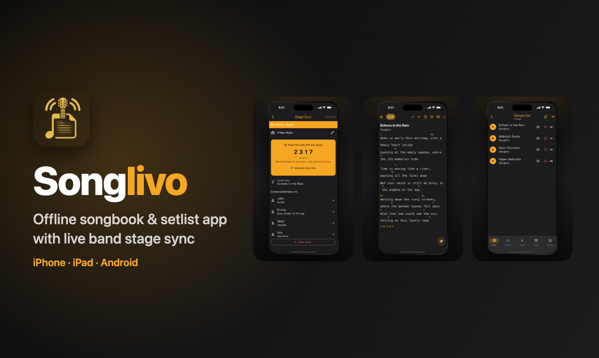
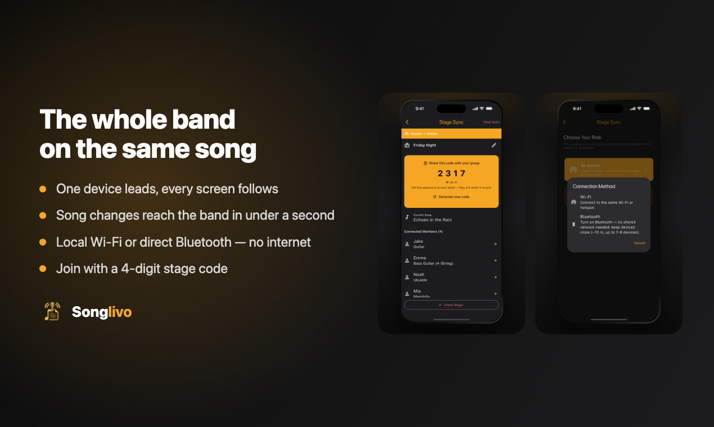
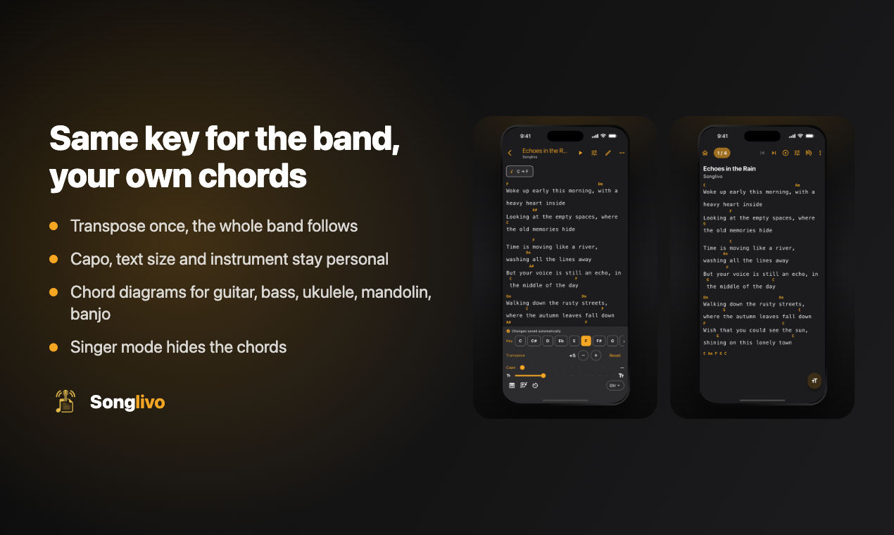
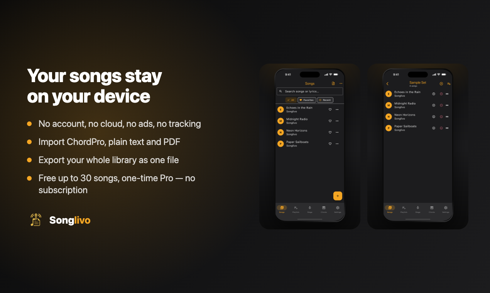
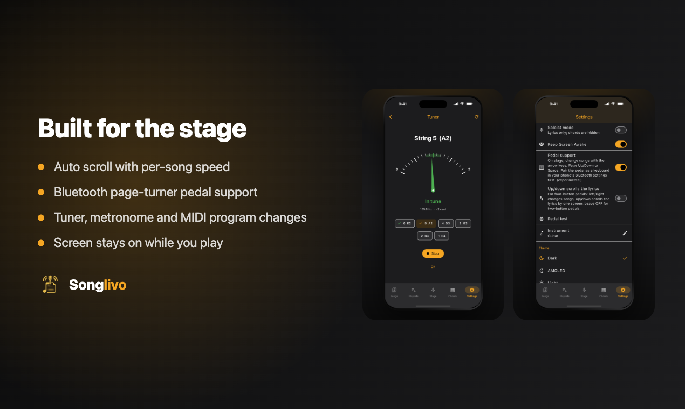

  

  
  
  
  

**Songlivo is an offline songbook and setlist app with live stage sync.** Chords, lyrics, setlists and transposition in one app, and the whole band on the same song at the same moment.

## The whole band on the same song

The leader picks the next song and every bandmate's screen switches with it, key included. It works over local Wi-Fi or direct Bluetooth, with no internet connection and no account; bandmates join with a 4-digit stage code. Capo, text size and instrument stay personal to each player.

## Same key for the band, your own chords

- **Transpose** once and every chord moves; slash chords and enharmonics handled.
- **Chord diagrams** for guitar, bass, ukulele, mandolin and banjo; bass mode shows root notes.
- **Singer mode** hides the chords and enlarges the lyrics.

## Your songs stay on your device

- **Local-first:** no cloud sync, no account, no ads, no tracking.
- Write songs with chords above the lyrics, or import [ChordPro](https://github.com/songlivo/chordpro-guide), plain text or PDF.
- Export a song, a setlist or your whole library as one file and open it on another phone.

## Built for the stage

Auto-scroll with per-song speed, Bluetooth page-turner pedals, a tuner, a metronome, MIDI program changes, and dark/AMOLED/light themes. Multilingual interface.

## Honest limits

- No cloud backup or cross-device sync — move your library with file export.
- No desktop version yet.
- No built-in song catalog: you bring your own songs.

## Pricing

Free to download with up to 30 songs. A one-time Pro purchase removes the limit — no subscription. Every other feature is free.

## Links

[Website](https://songlivo.com/en/) · [Step-by-step guide](https://songlivo.com/en/guide/) · [ChordPro guide](https://github.com/songlivo/chordpro-guide) · [YouTube](https://www.youtube.com/@songlivo) · info@songlivo.com
